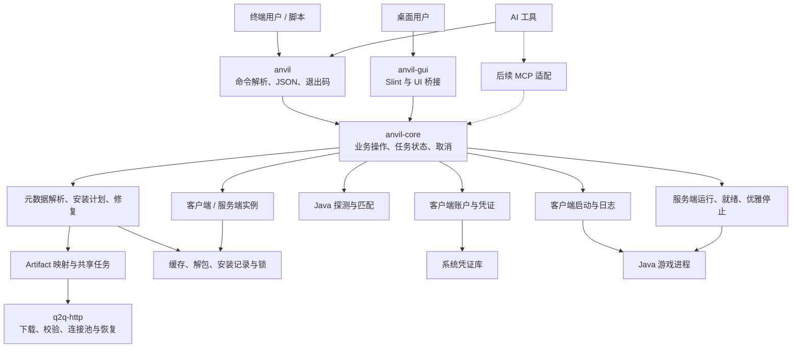
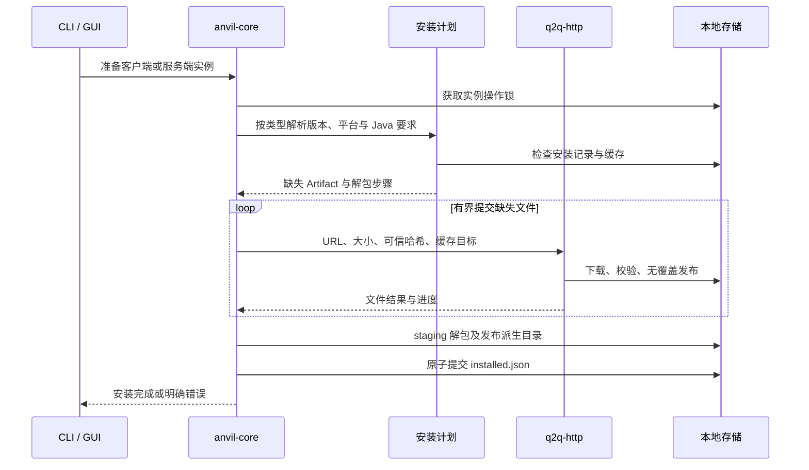
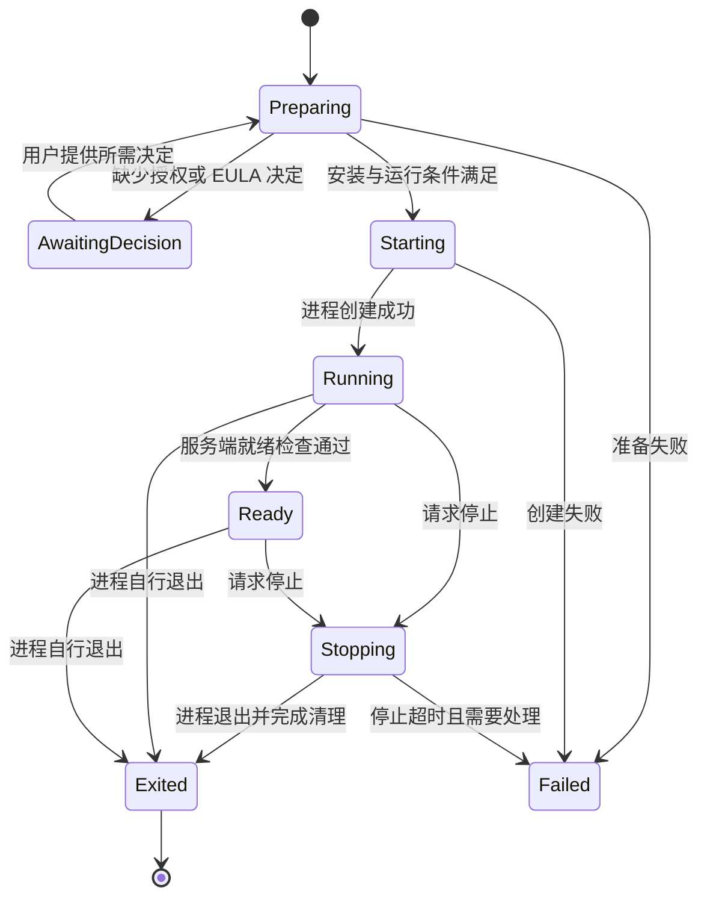

# Anvil 架构方案

状态：workspace、CLI、托管 Java 管理及原版服务端 `create` / `list` / `start` 首轮已实现；GUI 已有可选 Slint 基础入口，其余为目标结构。当前能力与验证边界见 [Java 管理](java-management.md) 和 [服务端实施项](server-milestone.md)。

Minecraft 文件清单、元数据差异和参数生成依据见 [Minecraft 文件安装与启动设计依据](minecraft-installation.md)，其中区分已核对的官方数据与仍需实际运行验证的行为。

## 产品定位与范围

Anvil 是面向 Windows、macOS 和 Linux 的轻量 Minecraft Java 版工具，统一提供客户端与服务端的实例创建、安装、Java 管理和启动能力。提供两个入口：`anvil` 为 CLI，`anvil-gui` 为 Slint 桌面应用，图形界面展示品牌名 Anvil。CLI 同时服务终端用户、脚本和 AI 工具，业务能力由公共 Rust 库提供。

首版建议支持选定的一组现代原版版本，客户端提供微软正版账户登录，服务端提供显式 EULA 接受与前台运行。明确验证各系统和 CPU 架构组合后再扩大范围；不因启动器可编译就宣称对应游戏版本可运行。模组加载器、整合包、云同步及模组市场后续单独设计。

资源目标是按需工作，无全局常驻服务、磁盘扫描或空闲网络轮询。下载、哈希、解包与日志缓冲均有界。客户端可以在生命周期保护机制完成后支持启动器退出；服务端托管按运行任务需要保留最小控制进程。资源收益以 release 构建测量为准。

## 工程与依赖边界

采用 Cargo workspace，初期建立三个 crate；根目录统一维护共享依赖、锁文件和构建配置：

```text
Anvil/
  Cargo.toml                       # 虚拟 workspace
  Cargo.lock
  crates/
    anvil-core/
      Cargo.toml
      src/                         # 客户端与服务端的业务模块
    anvil/
      Cargo.toml
      src/                         # CLI，生成 anvil 可执行文件
    anvil-gui/
      Cargo.toml
      src/                         # 桌面入口与 UI 桥接
      # 当前使用内联 Slint 基础窗口，后续按需拆出 ui/
  todos/
    architecture.md
  README.md
```

`anvil` 与 `anvil-gui` 直接调用 `anvil-core`，GUI 不通过 CLI 子进程执行普通操作。core 不依赖 Slint、命令行解析库、终端交互或 MCP 协议，不自行创建 Tokio runtime；每个入口拥有自己的运行时和业务上下文。CLI 构建不会引入图形界面依赖。

`q2q-http` 维护在 Q2Q 仓库，作为 core 的下载依赖。开发可使用本地覆盖或固定 Git revision，正式构建使用可复现的版本来源，不依赖开发者绝对路径。不复制其源码，也不自行再实现 Range worker、重试队列与下载恢复格式。



后续 MCP 是协议适配层，调用同一 core，不新增一套安装器。只有实际实施该入口时才决定是否增加独立 crate；当前不建立通用插件框架或本地 HTTP 服务。

## 核心模型与模块职责

客户端和服务端共享实例身份、版本、Java、安装与操作模型，通过显式类型区分启动规则与可变数据，不让客户端账户、assets 或 natives 变成服务端的必需依赖。

| 数据草案 | 含义 |
| --- | --- |
| `InstanceConfig` | 稳定 ID、名称、Client/Server 类型、版本、Java 选择、内存及类型对应的设置 |
| `ResolvedVersion` | 已解析的版本及继承规则、平台、Java 要求和对应侧的下载/启动描述 |
| `Artifact` | 来源 URL、大小、可信预期哈希、缓存位置与用途 |
| `InstallationPlan` | 实例、版本和平台身份、缺失文件、解包步骤与预期安装结果 |
| `RuntimePlan` / `NativePlan` | Java 文件树或发行包安装、旧 natives 提取与现代 native JAR 的不同准备步骤 |
| `InstalledManifest` | 成功提交的安装记录，绑定类型、版本、平台和文件引用 |
| `Operation` | 操作 ID、当前状态、进度、取消与完成结果；由调用者持有 |
| `LaunchSpec` | Java、argv、工作目录、环境和日志策略；含敏感参数，仅短期保留在内存 |
| `RunSession` | 实例与会话 ID、进程身份、运行模式、就绪和退出状态；不把裸 PID 当作持久身份 |

core 按职责使用平铺模块，不按每个模型拆 crate，不为尚未存在的扩展引入通用 trait：

| 模块草案 | 职责 |
| --- | --- |
| `context.rs` / `operation.rs` | 共享服务、操作所有权、事件快照、取消及清理 |
| `instance.rs` / `storage.rs` | 类型化配置、目录、原子存储、配置迁移及跨进程互斥 |
| `metadata.rs` / `platform.rs` | 元数据来源、继承与规则解析、OS/CPU 映射及客户端/服务端选择 |
| `install.rs` / `download.rs` | 安装计划、Artifact 调度、共享下载和修复提交 |
| `extract.rs` | 有界解包、路径和权限检查、派生目录发布 |
| `java.rs` | 有限候选探测、版本/架构匹配、托管 Java 安装 |
| `account.rs` / `credential.rs` | OAuth、Xbox/Minecraft 会话、刷新与凭证存储 |
| `launch.rs` / `process.rs` | 启动计划、直接创建进程、日志与平台生命周期 |
| `server.rs` | 服务端 EULA 状态、前台运行、就绪观测和停止流程 |

CLI 只负责参数、交互、输出格式和系统信号映射；GUI 只负责展示和交互。业务错误、默认行为与安装结果由 core 定义，两端不各自实现规则。

## 命令行与 AI 调用契约

CLI 按实施清单分阶段落地。当前可用 `version list` 查询 Mojang 版本目录、管理托管 Java，以及 `server create`、`server list` 和前台 `server start`。start 检查 EULA、准备匹配的托管 Java、持有实例锁、转发控制台和日志、观察 Ready、响应 Ctrl-C 并记录 `last-session.json`。JSONL 生命周期事件已提供；`server status` 与客户端安装命令仍待后续实现：

```bash
anvil version list --json
anvil instance list --json
anvil instance create my-world --version 1.21.1
anvil launch my-world

anvil server create survival --version 1.21.1
anvil server list --json
anvil server start survival --accept-eula
anvil --json-events server start survival --accept-eula
anvil server status survival --json
```

`server start` 组合检查、补齐 Java、处理 EULA 并启动，以一次命令完成准备。首次接受 EULA 必须由用户明确操作，记录接受状态及对应条款来源；非交互调用缺少接受决定时返回 `eula_required`，不能自动接受。原版服务端不要求玩家微软登录，但在线模式、玩家认证和服务端网络配置仍按游戏自身设置处理。

CLI 的自动化契约如下：

- 人类输出与机器输出使用同一业务结果。`--json` 输出一个 schema 版本化结果 envelope；普通诊断和进度写 stderr。服务端的 `stdout` / `stderr` 都转发到 Anvil 的 stderr，不混入 JSON stdout。
- 长时间前台启动使用 `--json-events`，只支持 `server start`。stdout 每行一个 schema 1 JSONL 事件，格式为 `{"schema_version":1,"event":"state","data":{"state":"..."}}`，写入后立即 flush。状态包括 `preparing`、`starting`、`running`、`ready`、`stopping`、`exited`、`failed` 和 `cancelled`；`running` 带 `session_id`，成功的 `exited` 带最终 session。Ctrl-C 在进程运行时发出 `stopping`，完成优雅关闭后再发 `exited`；准备阶段取消发终态 `cancelled`；错误发终态 `failed` 并包含稳定错误对象，服务端进程错误另外给出 `process_exit_code`。服务端日志仍写 stderr。
- `server start` 只有观察到 Minecraft 的 Ready 日志并以退出码 0 结束，才报告成功；进程在 Ready 前退出，即使退出码为 0，也以 `server_not_ready` 失败。`--json` 在命令退出后只输出一个最终结果；需要运行中状态时用 `--json-events`。
- 非交互模式不弹隐式确认或等待终端输入；缺少账户授权、EULA 等决定时返回类型化错误与下一步操作。需要授权的能力仍保留明确的交互流程。
- 当前稳定退出码：`2` 参数错误；`3` 平台不支持、资源不存在/忙/冲突或缺少前置条件；`4` HTTP 错误；`5` 服务端启动、退出或 Ready 失败；`6` 元数据、归档、Java、完整性、JSON、worker 或 I/O 错误；`130` 取消。JSON 错误对象同时包含稳定 `code`、说明和 Anvil 退出码。
- 名称用于展示与便捷查找，稳定 ID 用于自动化。重试同一实例创建/安装/启动时，应返回已有匹配结果或明确冲突，不能生成重复实例或第二个服务端。
- 普通安装命令等待结束；长时间运行命令明确其前台生命周期。只返回“进程已创建”时不能声称服务器 Ready。

AI 首先可以调用同一 CLI；后续 MCP 将操作和查询映射为工具，复用相同错误、状态及权限边界。长任务通过任务句柄和状态查询表达，不能因为 MCP 请求结束而遗留无所有者任务。

## 安装、缓存与恢复



客户端计划包含游戏 JAR、规则筛选后的库、资源索引与对象、平台 native JAR 及日志配置。旧 classifier 归档提取和现代普通 native artifact 分别处理，后者保留所需 classpath 条目。调试 mappings 不属于启动必需文件。服务端计划获取 downloads.server；原版 bundler 入口按其自身布局启动，不沿用客户端 mainClass 或库清单。

客户端元数据解析覆盖库 rules、natives classifier、extract exclude、参数 rules 和 feature 开关；历史 minecraftArguments 与现代 arguments 数组分别解析。26.3 的 default-user-jvm 和 os.versionRange 也需在支持该格式前核对求值与覆盖语义，不能忽略未知条件后默认放行。版本继承的循环/深度边界及 mod loader 合并规则另行验证。可信官方元数据通过 TLS 获取，有父级哈希时按原始响应字节验证；镜像仅替换文件来源，不替换预期哈希。部分元数据没有期望长度，走共享 HTTP Executor 的有界读取，不伪造 Artifact 大小。

同一进程的业务上下文持有一个 q2q-http Downloader，共享连接池和预算。同一缓存目标的任务可以合并；撤销一个操作只取消该订阅，最后一个使用者退出后才取消下载。不同 CLI/GUI 进程通过文件锁协调，不声称共享进程内连接池或全局并发预算；目标忙不等于文件已完成。

安装是可恢复的步骤集合，全部必要步骤成功才提交新的 installed.json。失败保留旧记录和已验证缓存，不覆盖存档、世界或用户配置。解包限制总量和条目数，检查路径穿越与链接目标；Java 发行包的链接/执行权限按明确规则处理。派生目录在同文件系统 staging 完成后发布，避免半解包结果可见。

使用系统应用数据、缓存和日志目录，CLI 与 GUI 默认解析到同一个用户数据根；显式数据根覆盖要在所有入口一致生效。服务账户可使用独立数据根，core 不隐式提升权限。

```text
应用数据目录/
  config.json
  accounts.json                     # 非敏感账户信息，令牌在凭证库
  instances/<id>/
    instance.json                   # 类型为 Client 或 Server
    installed.json
    server.jar                      # 服务端官方 artifact，身份记录在 instance.json
    game/                           # 客户端 saves/mods/config 或服务端 world/properties 等
  runtimes/<runtime-id>/
  locks/                            # 跨进程稳定锁
  sessions/                         # 运行身份与状态记录，不存令牌
缓存目录/
  metadata/
  libraries/
  assets/objects/
  assets/indexes/                    # 按 assetIndex.id 保存，未必等于游戏版本
  clients/
  servers/
  natives/<identity>/                # 不可变提取模板；可写 native 工作目录归运行会话
  staging/
日志目录/
  launcher/
  sessions/<session-id>/
```

实例隔离可变数据，共享不可变依赖。固定 Maven 路径等布局按上游规则保留并检查内容碰撞；natives 模板由平台和输入文件身份决定，实际可写提取目录位于对应运行会话下，避免多个实例共用写入路径。缓存可被系统清理，启动时检查必需文件并修复，主动检查执行完整校验；普通启动不全盘重哈希，因此不承诺检测所有同长度外部篡改。

## 账户与 Java

客户端账户使用公共应用适用的微软 OAuth 流程，并完成 Xbox/Minecraft 所需的会话与身份获取。core 提供授权请求与结果状态，GUI 可打开系统浏览器，CLI 可展示授权 URL 或受支持的设备码流程；应用注册、权限和可用授权方式需在实施时确认。core 不依赖浏览器 UI，不嵌入客户端密钥，也不把微软登录成功等同于游戏授权完成。

刷新令牌保存到系统凭证库，配置和任务快照只包含账户标识。凭证库不可用时明确失败或允许仅当前会话授权，不静默写明文；并发刷新按账户合并。服务端安装与运行不触发客户端账户登录，方便 headless 环境使用。

Java 从用户路径、托管运行时及有限系统候选按需探测，检查主版本、架构和可执行性，缓存结果且不后台扫描。安装源、预期哈希和平台映射需要明确。客户端还要核对 natives 架构；服务端同样不能仅凭启动器架构推断所需 Java。

官方 javaVersion 指定运行时 component 和主版本，实际已核对样本覆盖 Java 8/17/21/25。官方 Java 运行时清单采用 directory/file/link 文件树，不能仅建模成 ZIP 解包；RuntimePlan 要表达 raw 文件、大小/哈希、执行权限、受限链接和整体发布。若采用其他发行包，使用其明确校验和归档规则。

## 运行会话与服务端控制

安装状态和运行状态分别管理；安装成功不代表 Java 已启动，进程已创建不代表客户端进入主菜单或服务端已就绪。



LaunchSpec 使用 `std::process::Command` 或平台封装直接传 argv，按平台生成 classpath、工作目录、环境和 natives 参数，不拼接 shell。客户端顺序为 JVM 参数、mainClass、game 参数；规则求值后展开占位符并保留参数边界，logging.client.argument 在 mainClass 前加入。必需 JVM 参数、上游用户默认项和用户覆盖项分别处理，避免内存或 GC 参数冲突。客户端会话参数可能含 access token，完整 argv、会话和授权响应不写日志，UI/JSON/MCP 只得到脱敏数据；不能保证本机进程检查工具看不到游戏协议要求的参数。

客户端可选择保留入口监控，也可在成功创建进程后退出。脱离模式将 stdout/stderr 重定向到日志文件，不能遗留无人消费的 pipe。实例互斥必须覆盖游戏生命周期；跨平台继承锁或等价机制验证完成前，先使用保留控制进程的方式，不提前承诺完全退出。进程脱离和创建失败分别验证。

服务端首版 `anvil server start` 默认前台运行，由 CLI 持有子进程、stdin、日志和实例锁。前台信号映射为优雅停止：发送游戏 `stop`、持续消费输出、等待保存与退出。服务端输出通过显式日志通道或文件提供，不混入 JSON stdout。设置停止超时，超时明确报告仍在运行；强制终止是单独的显式决定，不能静默丢失世界保存。

服务端 Ready 需要与支持版本匹配的就绪证据及超时策略，不能仅看到 PID 或端口开放就判定完全可用。状态查询返回进程状态和就绪状态；进程异常退出必须报告退出结果，不能永久保留 Running。

后台启动、跨命令 `stop`、远程控制台和 AI 长期托管需要一个明确的服务端进程所有者，后续作为独立阶段实现。建议按需启动最小监督进程，持有 stdin、实例锁和退出观察，通过本地 IPC 接收状态/停止请求，最后一个托管服务端退出后结束。协议要核验当前用户和会话身份；不单凭记录文件中的 PID 发信号，避免 PID 复用误操作。未完成监督协议前不提供假成功的 `--detach` 或跨进程 stop。

## 任务、界面与并发

操作持有取消信号、状态与后台任务；同一实例的安装/修复与运行互斥，其他实例可在共享预算下并行。GUI、CLI 和后续 MCP 均需遵守同一跨进程锁。记录原子写入，终态在清理完成后公布，不以删除状态文件代替停止进程。

CLI 将系统信号映射为 core 取消或服务端停止，保持清理语义。Slint 在主线程运行，后台通过有界命令与可合并快照协作，用事件唤醒更新 UI；不跨线程直接访问 UI，也不固定周期刷新空闲界面。UI 关闭后清理它拥有的安装任务；已有运行会话按显式运行模式处理。

网络工作使用调用方 runtime，阻塞磁盘、解包、哈希和 Java 探测使用有界阻塞任务。慢终端、UI 或 AI 消费者不阻塞下载；可靠终态与合并进度分开处理。跨请求长期任务必须有明确所有者和可查询状态，不能由一个已经结束的调用隐式托管。

## 实施阶段与验收

1. [ ] **Workspace 与核心接口（部分完成）。** 建立 anvil-core、anvil、anvil-gui，CLI 可独立构建；统一实例、数据根、配置、错误、任务及取消模型，GUI 接入最小 Slint 桥接。
2. [x] **Java 管理首轮。** Temurin 大版本/精确版本解析、q2q-http 下载、受限解包、可执行性检查、安装记录、列表/卸载与 JSON 输出；Linux 真实安装及本地测试通过。Windows/macOS 结果待远端 CI，详见 Java 管理文档。
3. [ ] **版本与安装计划。** 已完成 Mojang 版本目录查询；仍需选定首批客户端版本和架构，解析并校验版本 JSON、Java 要求、Artifact 和修复计划，按客户端/服务端类型验证资源集合。
4. [ ] **Minecraft 下载与安装。** 在 Java 安装已接入 q2q-http 的基础上扩展游戏文件计划、共享缓存、恢复、natives 解包与 installed.json 提交，不重复实现下载引擎。
5. [ ] **服务端 CLI（分步实施中）。** 已完成版本元数据、q2q-http 服务端 JAR 下载、`create` / `list`、Java/EULA 预检、前台 `start` 生命周期和 JSONL 自动化事件；按 [服务端实施项](server-milestone.md) 完成 Ctrl-C 与跨平台验证。
6. [ ] **客户端与桌面流程。** 完成授权、凭证库、参数、真实启动、GUI 实例与账户管理，验证日志、监控与客户端脱离方式。
7. [ ] **后台托管与 AI 接口。** 评审并实现监督进程、本地 IPC、跨命令状态与 stop，再接入 MCP；在长期任务所有权明确后提供后台一键启动。
8. [ ] **跨平台与资源收敛。** 按具体 OS/CPU/游戏版本验证，完成 CLI 与 GUI 分别打包、签名/更新方案及资源测量；之后再扩展模组与整合包。

重点验证规则解析、缓存去重与取消隔离、headless 服务端无账户依赖、JSON 输出纯净、重复命令、跨进程互斥、EULA 缺失、断网恢复、解包边界、Java 不匹配、服务端保存退出、PID 复用和入口退出后的进程生命周期。区分单元/集成检查、真实游戏运行、CI 和发行验证，不把单个平台编译通过视为全部支持。

## 实施前需收敛的选择

Java 发行包首个来源已确定为 Temurin；首批游戏版本与 OS/CPU 验收矩阵、客户端默认退出模式、GUI 交互与内存默认值，需要在对应阶段确定。服务端后台监督的 IPC 和托管方式、MCP 协议入口以及发行更新机制分别在实施前评审；这些选择不阻碍先建立 workspace、核心模型与安装计划。
