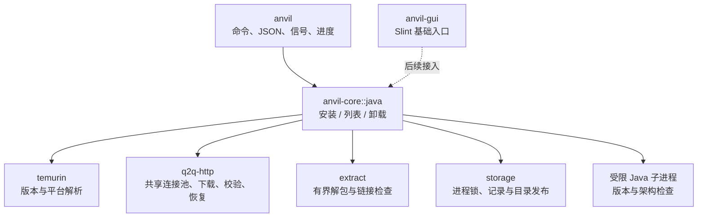

# Java 管理

状态：首轮实现完成；验证范围见文末。Java 是首个业务模块，先建立独立可用的运行时管理，再接 Minecraft 元数据与启动。

## 工程边界



core 不依赖 clap 或 Slint，不自行创建异步运行时。Context 持有一个 Downloader 和两个阻塞任务的预算；CLI 使用 current-thread Tokio runtime。GUI 当前只有可选基础窗口，尚未接入 Java 交互；不建立未使用的实例、账户或进程模型。

`q2q-http` 使用 Q2Q 的固定 Git revision `5e98cfc55b2712dfc6741d3f17c0cc14fcb57353`。后续升级应显式更新 revision 和 Cargo.lock；本阶段不依赖 crates.io 尚未发布的版本或开发者绝对路径。

## 命令与版本含义

```bash
anvil java install --version 21
anvil java install --version 21.0.8+9
anvil java install --version 17 --vendor temurin
anvil java list
anvil java uninstall <runtime-id>
anvil --json --data-dir ./anvil-data java install --version 21
```

- `--version 21`：查询 Temurin 的该大版本最新 GA，记录解析后的完整版本，不固定为某个 Minecraft 版本。
- 精确版本采用现代 Java 的数字版本及 build，如 `21.0.8+9`。使用 Adoptium 的补丁范围查询，再严格匹配完整版本，不接受近似版本。
- 大版本范围 8–99；Java 8 支持大版本安装，旧式 `8u...` 精确语法未实现。
- `--vendor` 当前只接受 `temurin`，供应商与版本参数分开。
- 优先 JRE；同版本与平台没有匹配 JRE 时查询 JDK。网络失败不伪装成“无 JRE”。
- `list` 只读取托管运行时记录并检查可执行文件存在，不扫描系统、不执行所有 Java。
- 服务端预检使用 `JavaManager::ensure_major` 按 Java 主版本、当前 OS/架构筛选托管运行时，并实际探测候选的版本、架构和可执行性；没有可用候选时按大版本安装 Temurin。它不会扫描系统 Java。
- 同一解析版本重复安装会核对安装记录、SHA-256 身份并重新探测 Java，返回 `already_installed: true`。大版本请求仍需联网解析最新版本。
- 卸载只处理匹配 ID 的托管目录，保留归档缓存。尚未有运行会话，因此不提供“Java 正被游戏使用”的检测；实施启动能力时必须扩展锁的生命周期。

## 平台与目录

平台按运行 Anvil 的目标选择：Windows、macOS、glibc Linux；CPU 支持 x86_64 和 aarch64 映射。上游没有对应版本/平台包时明确失败，不转而安装其他架构。musl Linux 暂不支持。映射存在不等于这些平台的安装和游戏运行已验收。

默认目录由 `directories::ProjectDirs` 按系统用户约定解析。CLI 的 `--data-dir ROOT` 或 `ANVIL_DATA_DIR` 覆盖数据根，此时缓存位于 `ROOT/cache`。不提升权限、不修改环境或系统 Java。

```text
数据根/
  runtimes/<runtime-id>/
    anvil-runtime.json              # schema 1；相对 Java home、版本、平台、归档 SHA-256
    <上游归档顶层目录>/
  locks/java-<runtime-id>.lock       # 稳定 OS 锁文件；释放锁后文件可以保留
缓存根/
  java/<sha256>.tar.gz              # Windows 使用 .zip
  java/<sha256>.*.q2q-http.*        # 下载器自身的暂存、恢复和锁文件
```

runtime ID 由供应商、完整版本、JRE/JDK、系统与架构组成。不要解析 ID 推断结构；自动化使用 JSON 中的独立字段。

## 安装事务与资源预算

1. 校验参数，从可信 TLS API 有界读取元数据（2 MiB），核对版本、平台、发行版、归档格式、大小和 SHA-256。
2. 获取目标运行时的跨进程 OS 文件锁；冲突返回 `busy`，不把忙误报成已安装。
3. 通过共享 Downloader 恢复/下载内容寻址的归档并验证整文件哈希。预算为 4 个文件、8 个请求、单 host 4 请求和 2 个下载磁盘任务。
4. 在 runtimes 内创建同文件系统临时目录，有界阻塞解包。只接受普通文件、目录及受限的 tar 文件链接；拒绝路径穿越、设备等特殊条目、重复路径与超限归档。文件链接在普通文件完成后复制为文件，避免依赖 Windows symlink 权限；目录链接、循环链接及 ZIP symlink 不支持。
5. 直接创建 Java 子进程运行 `-XshowSettings:properties -version`，核对完整运行时版本和架构。限制 15 秒、每路输出 64 KiB，清除 JVM 注入参数环境变量，不经过 shell。
6. 写入安装记录，临时目录重命名到正式运行时目录。失败保留已验证下载缓存，正式目录不出现半解包结果。

解包最多 100,000 个条目、2 GiB 展开内容（包括链接文件副本），单归档最多 1 GiB；链接依赖最多解析 64 轮。磁盘、解包和元数据读取在独立有界阻塞预算内运行。进度用 watch 合并，终端输出最多约每 250ms 一次，阶段变化立即更新；JSON 模式关闭进度输出。

Ctrl-C 请求取消并等待下载器清理、已开始的阻塞任务和探测进程结束。下载暂存由 q2q-http 管理：部分恢复要求同源且强 ETag；无有效恢复依据时重新下载。归档已完整时重新校验后复用。不在 Anvil 中重复实现 Range 调度或恢复日志。

下载最终发布要求文件系统支持硬链接。安装目录发布通过 Anvil 的稳定锁协调；不提供对任意外部写入者的事务隔离，也未验证断电持久性。进程被强制结束可能留下隐藏的 `.install-*` / `.remove-*` 目录；当前不自动扫描/清理它们。归档缓存损坏会明确失败，暂不提供 cache repair 命令。

## 自动化契约

成功时 stdout 输出一个对象：

```json
{"schema_version":1,"ok":true,"data":{"runtime":{"id":"…","vendor":"temurin","version":"21.0.8+9","major":21,"image_type":"jre","os":"linux","arch":"x64","java_home":"…","executable":"…"},"already_installed":false}}
```

列表的 data 是 `{ "runtimes": [...] }`，卸载为 `{ "removed": {...} }`。错误对象为 `{ "schema_version": 1, "ok": false, "error": { "code": "…", "message": "…", "exit_code": 6 } }`。message 面向人类，不作为自动化判断条件；成功路径是绝对路径。帮助和工具自身 `--version` 保留标准 clap 文本输出。

退出码：0 成功；2 参数错误；3 前置条件/未找到/冲突/忙；4 HTTP 请求失败；6 文件、元数据、校验、解包、Java 或内部错误；130 取消。错误 code 进一步区分 `integrity`、`invalid_archive`、`invalid_java`、`invalid_metadata` 等。

## 后续接入边界

- 从 Minecraft 元数据中的 javaVersion 解析主版本/官方运行时 component；供应商安装与官方文件树安装是不同来源策略。
- 加入有限系统 Java 探测和显式用户路径，按版本、架构与游戏侧规则选择，而不是修改全局默认 Java。
- 游戏运行时持有 Java 使用锁，卸载和修复不能影响活跃会话。
- GUI 使用同一 Context 与 JavaManager，并复用进度和取消 API。
- 下载跨操作合并、完整的任务句柄和缓存维护在真正需要时加入；当前同目标并发返回 busy。

## 本轮验证

- Adoptium API 实际验收大版本 Java 21、Java 17 和精确版本 `21.0.8+9`。三种安装均执行了重复安装、独立 `java -version`、JSON 列表与卸载，缓存保留。
- 真实 CLI SIGINT 验收：等一个 range 已写入恢复记录后发送 SIGINT，CLI 返回 JSON `cancelled` 与退出码 130；随后安装成功恢复，完整完成列表与卸载。
- 自动化：CLI 5 项、core 17 项通过。覆盖版本解析、跨进程文件锁、JSON/参数错误、tar/zip 解包、路径穿越、链接循环、哈希不匹配、Java 探测失败清理、重复安装/卸载、并发忙状态及取消后的分段续传。恢复用例确认已提交的第一个分段没有重下。
- `cargo build -p anvil --locked --offline`、`cargo clippy -p anvil -p anvil-core --all-targets --locked --offline -- -D warnings` 和 `cargo fmt --all -- --check` 通过。
- Slint 基础入口 `cargo check -p anvil-gui --features desktop --locked --offline` 通过。此环境缺少系统开发包；检查时从 Debian 官方包临时解压 Fontconfig/FreeType 等 pkg-config 元数据，并通过命令级 PKG_CONFIG_PATH 指定，未写入仓库。
- Linux、Windows、macOS 自动测试与 Linux 桌面构建由 GitHub Actions 运行。真实 Temurin 安装不加入 CI；`scripts/java-smoke.py` 可在目标平台本地运行。当前 Windows/macOS 的真实安装尚未验收，不把 Linux 结果视为其他平台已通过。

真实安装检查使用隔离临时数据目录；测试和 smoke 脚本不写用户系统 Java 目录。可用 `python scripts/java-smoke.py --binary target/debug/anvil` 重复 Linux 真实验收，`--check-interrupt --versions 21` 会增加分段落盘后的取消/恢复检查。
