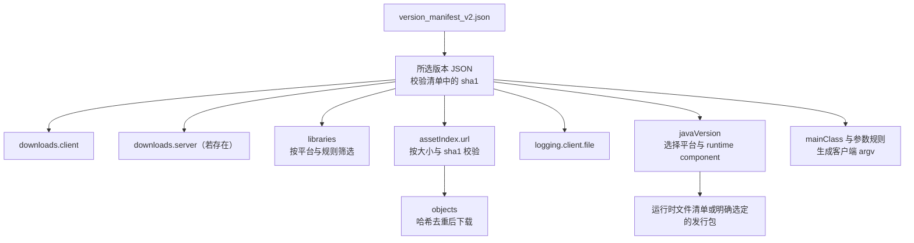

# Minecraft 文件安装与启动设计依据

状态：资料核对与实现依据（资料核对日期：2026-10-21；实现状态更新：2026-10-22）。Mojang 版本目录查询、首版客户端版本 JSON 解析、平台安装计划、客户端文件安装、运行目录准备、账户授权 provider、系统凭证库适配、账户资料存储及 CLI 登录/启动流程均已实现。真实 Microsoft 交互登录、系统凭证库写入、真实 Java 与客户端运行，以及各目标平台的客户端 smoke 尚未验收。

本文为 [整体架构](architecture.md) 中 metadata、install、java 和 launch 模块提供具体输入与边界。安装清单和 argv 必须从所选版本的元数据生成；示例版本用于说明格式差异，不表示 Anvil 已支持或已运行这些版本。

客户端从版本目录到安装、授权与启动的执行顺序见[原版客户端首条可用流程](client-milestone.md)。

## 资料来源与核对范围

参考 Minecraft Wiki 的 [Game files](https://minecraft.wiki/w/Minecraft_Wiki:Projects/wiki.vg_merge/Game_files) 与 [Launching the game](https://minecraft.wiki/w/Minecraft_Wiki:Projects/wiki.vg_merge/Launching_the_game)。本次 Wiki 正文访问被 robots 限制，仅取得搜索索引中的相关内容；其中有历史格式说明及待完善信息，不能替代官方实际元数据。

本次实际获取 [Mojang 版本总清单](https://piston-meta.mojang.com/mc/game/version_manifest_v2.json)，并逐一按父清单中的 SHA-1 校验以下版本 JSON 的原始字节：

| 样本 | 官方版本 JSON | 实际字段差异 |
| --- | --- | --- |
| 1.12.2 | [832d95b9…](https://piston-meta.mojang.com/v1/packages/832d95b9f40699d4961394dcf6cf549e65f15dc5/1.12.2.json) | Java 8；minecraftArguments 字符串；旧 natives/classifiers |
| 1.13 | [c24c2fd3…](https://piston-meta.mojang.com/v1/packages/c24c2fd37c8ca2e1c18721e2c77caf4d24c87f92/1.13.json) | 实际已有 arguments.game / arguments.jvm 数组 |
| 1.20.4 | [ee2bc046…](https://piston-meta.mojang.com/v1/packages/ee2bc046cef978a91a7494e760a32d4f7f3e835c/1.20.4.json) | Java 17；规则化参数数组 |
| 1.21.1 | [1757c8b1…](https://piston-meta.mojang.com/v1/packages/1757c8b1fbfc6b638504e1f6cceb05893f7389d5/1.21.1.json) | Java 21；native JAR 作为普通 artifact 列出 |
| 26.3 | [61fff131…](https://piston-meta.mojang.com/v1/packages/61fff1316bd50312624a858bbb5eb18fa45208ed/26.3.json) | 本次总清单的 latest.release；Java 25；新增 default-user-jvm 和 os.versionRange |

还获取并校验了 1.21.1 的 [资源索引 17](https://piston-meta.mojang.com/v1/packages/e61ea955de95de1f99d36616a8b46147e9f6f5d7/17.json)、官方 Java 21 Linux 运行时文件清单，以及通过少量 Range 读取了 1.21.1 官方服务端 JAR 的 ZIP 目录和 bundler 元数据。后者核对了 ZIP 条目 CRC，未下载整个 JAR，不能声称完成其整文件 SHA-1 校验。未执行游戏、登录或服务端运行验证。

## 元数据依赖链

当前 CLI 可用 `anvil version list` 读取大小受限的 Mojang 版本清单，并列出版本 ID、类型与发布时间；`--json` 使用 CLI 的 schema 1 envelope。清单中的 ID、类型、时间、SHA-1 和版本 JSON URL 会先校验。该命令不下载版本 JSON、游戏文件、资源或 Java，也不代表对应版本已可安装或运行。

Core 的 `metadata::resolve_client` 已复用共享 HTTP Executor，按总清单中的 SHA-1 校验原始版本 JSON 字节后，解析 1.21.1 首条客户端流程所需的游戏 JAR、asset index、Java 要求、main class、libraries 与现代参数数组。版本 JSON 响应限制为 4 MiB；client JAR 和 asset index 元数据尺寸分别限制为 1 GiB 与 16 MiB。该解析器不下载文件、不筛选 libraries rules，也不展开启动参数；尚未实现文件安装的版本仍不表示可启动。

Core 的 `client_plan::plan_client` 依据目标平台筛选 libraries，并要求调用方提供与版本 JSON 中长度和 SHA-1 一致的 asset index 字节。它按资产内容哈希去重，生成 libraries、client JAR、资源对象、asset index 和日志配置的计划；不会执行下载或解包。对官方 1.21.1 样本，Windows x86_64、macOS x86_64/aarch64 和 glibc Linux x86_64 可生成计划；Linux aarch64 缺少 LWJGL ARM native，返回 unsupported。以上是元数据计划结果，不等于真实文件已安装或游戏已启动。

元数据与普通 Artifact 分开处理：总清单和部分版本 JSON 引用不提供长度，不能伪造大小来调用要求 expected_size 的 q2q-http 高层文件 API。metadata 模块通过共享 HTTP Executor 使用有界完整 GET，限制最大响应大小；有预期 SHA-1 时按原始响应字节验证，再解析 JSON。已知大小的索引和文件可进入 Artifact 下载流程。总清单的信任依赖官方 HTTPS 来源，并不具有本方案额外假定的数字签名。

## 客户端必须准备的内容

| 内容 | 元数据入口 | 处理方式 |
| --- | --- | --- |
| 版本 JSON | 总清单 versions 条目 | 保留其内容身份，解析所需功能和规则 |
| 游戏 JAR | downloads.client | 按 url、size、sha1 下载并校验，加入 classpath |
| 普通库和平台库 | libraries[].downloads.artifact | 先筛选规则，使用明确的 path/url/size/sha1；不只按 Maven 名称猜路径 |
| 旧格式 native 归档 | natives + downloads.classifiers | 按平台/架构选 classifier，并按 extract.exclude 安全解包 |
| 新格式 native JAR | 带平台规则的普通 artifact | 保留元数据要求的 classpath 条目；与旧 classifier 解包路径区分 |
| 资源索引 | assetIndex | 存为 assets/indexes/<id>.json，id 不一定等于游戏版本号 |
| 资源对象 | 索引 objects 的 hash/size | 哈希去重后下载到 assets/objects/<前两位>/<hash> |
| 日志配置 | logging.client.file | 下载并校验，用 logging.client.argument 替换其中的 path 占位符 |
| Java | javaVersion 与平台运行时描述 | 先复用兼容 Java，否则安装托管运行时 |

资源对象的标准地址形态为 `https://resources.download.minecraft.net/<hash 前两位>/<hash>`。实际索引 17 包含 3911 个逻辑名称，对应 3888 个唯一内容哈希，下载任务应按内容去重。assetIndex.totalSize 不是索引 JSON 大小，也不能替代逐对象 size。

downloads 中的 client_mappings、server_mappings 等调试映射不属于普通游戏启动必需文件；不能将 downloads 下的所有条目无差别下载。皮肤、服务器资源包、存档等由游戏运行或用户操作产生，也不属于原版基础安装清单。

历史版本可能要求虚拟资源目录或旧参数布局，首版支持范围需要明确。未实现相关模式时明确拒绝对应版本，不将现代 assets 路径直接套用。

## 平台规则与 natives

1.12.2 样本同时包含 natives、downloads.classifiers 和 extract.exclude；1.21.1 样本没有这些 natives/classifiers 字段，但有 48 个名称含 natives- 的普通库 artifact，覆盖多个平台，不能全部下载，也不能因为缺少旧字段就漏掉它们。Anvil 的计划器会将现代 native JAR 保留为 classpath artifact，将旧 classifier 归档放入独立的提取计划，并拒绝目标平台没有匹配 native 的计划。实际解包仍属后续工作。

解析根据元数据结构与规则处理，不只匹配文件名。对现代 LWJGL 等库，native JAR 需要在 classpath，运行时提取行为按库和版本验证；对旧 classifier 路径，按原语义准备提取目录。

原生库共享的是不可变归档和可选的已验证提取模板，运行会话使用独立的 natives 工作目录。26.3 的 JVM 参数分别指定 java/jna/lwjgl/netty 子目录；这些可能被运行时写入的路径不能直接指向多个实例共用的可变缓存。

rules 至少涉及 OS 名称、架构、版本匹配及 feature 条件。26.3 还存在 os.versionRange，且 default-user-jvm 条目可没有 rules。范围端点、组合规则的确切求值和未知条件行为需要专项确认及样例验证；识别不了的条件返回不支持，不能当成无条件 allow。对声明要支持的版本实现其所需能力后，才纳入支持矩阵。

## 客户端参数生成

客户端 argv 的基本顺序为：Java 可执行文件、JVM 参数、版本 mainClass、游戏参数。使用独立 argv 元素传递，路径含空格也不能再次交给 shell 拆分。

现代版本读取 arguments.jvm / arguments.game，元素既可能是字符串，也可能是带 rules 的对象；value 可为字符串或字符串数组。先判断条件，再展开 value 和占位符，保持元数据顺序与参数边界。1.12.2 实际仍使用 minecraftArguments 字符串，不能依照旧 Wiki 概述把它当作已使用现代数组格式；历史字符串解析另走明确的兼容路径。

占位符的提供者如下，不能以空字符串掩盖未实现字段：

| 来源 | 典型占位符 |
| --- | --- |
| 游戏账户会话 | auth_player_name、auth_uuid、auth_access_token、auth_xuid、user_type（仅所选版本要求时） |
| 应用注册与品牌 | clientid、launcher_name、launcher_version；clientid 不能填 Anvil 名称或伪造 UUID |
| 版本信息 | version_name、version_type |
| 安装与会话路径 | game_directory、assets_root、assets_index_name、natives_directory、classpath |
| 用户选项和功能 | resolution_width/height、Quick Play 对应字段，只有匹配的 feature 开启才加入 |

classpath 按选中库及版本游戏 JAR 构造，保持确定顺序，使用目标系统路径分隔符。不要把旧版仅用于提取的 classifier 归档误加为普通库，也不要从现代 classpath 中移除其要求的 native artifact。

日志配置 argument 属于 JVM 参数，应在 mainClass 前加入。macOS 的 -XstartOnFirstThread 等平台参数按规则处理。Quick Play、试玩和分辨率参数由能力及用户选择启用，不能统一塞给所有版本。

26.3 的 arguments.default-user-jvm 给出了默认堆内存和 GC 选项，还新增 native access 等 JVM 参数。Anvil 要显式定义“上游默认值、应用资源策略、用户自定义参数”的优先级，并校验与选中 Java 的兼容性，避免重复 -Xmx 或多个 GC 冲突。先核对规则及覆盖语义，不盲目复制与低资源目标冲突的 AlwaysPreTouch 等默认项，也不把用户默认项和必需 JVM 参数混为同一组。

minimumLauncherVersion 是上游能力提示，不是 Anvil 的版本号；不能直接和 Anvil semver 比较。版本继承属于进一步的兼容能力，本次取得的原版样本没有验证 mod loader 的继承约定，需另行核对后实现。

## Java 安装来源与布局

本次样本的 javaVersion 分别要求 Java 8、17、21 和 25，使用 jre-legacy / java-runtime-gamma / delta / epsilon 等 component。按所选版本读取，不把固定 Java 主版本写死到启动器。

Wiki 指向的 [官方运行时总清单](https://launchermeta.mojang.com/v1/products/java-runtime/2ec0cc96c44e5a76b9c8b7c39df7210883d12871/all.json) 本次可访问，其中按平台和 component 给出版本及文件清单描述；这只是当前取得的来源，入口更新和支持矩阵仍需维护。已取得的 [Linux delta 文件清单](https://piston-meta.mojang.com/v1/packages/06a3884df3d9d4072b9b6df541495d81878ad2de/manifest.json) 包含 423 个条目，类型为 directory、file、link。file 有 raw 下载、可选 lzma 下载及 executable 标志。

因此 RuntimePlan 需要支持文件树安装，不能只定义“下载 Java ZIP 再解压”。若首版采用该官方清单，优先 raw 文件以降低解压复杂度，逐文件校验，处理目录、合法相对链接与执行权限，在 staging 完成后发布运行时。若改用其他可信 JDK 发行包，需要明确其平台映射、校验与归档规则。当前清单并不保证覆盖所有 Anvil 目标架构，缺少组合时明确报告，不隐式下载错误平台版本。

## 原版服务端准备与启动

从版本 JSON 的 downloads.server 获取该版本服务端 JAR（字段可能不存在），按 size/sha1 校验。服务端不使用客户端 mainClass、游戏账户参数、assets 或客户端 natives。官方 [服务端下载说明](https://www.minecraft.net/en-us/download/server) 要求兼容 Java，并说明 nogui 控制服务端图形窗口。

普通原版服务端的启动计划形态为 `java <JVM 参数> -jar <已验证 server.jar> nogui`，工作目录是该实例的 game 目录；这些是 argv 的分组示意，实际由 Command 传参。EULA 接受、server.properties、世界和日志属于实例数据，不放进共享不可变缓存。

对 1.21.1 server.jar 的局部 ZIP 核对发现：MANIFEST.MF 的 Main-Class 是 net.minecraft.bundler.Main，META-INF/main-class 指向 net.minecraft.server.Main，另有 libraries.list 与 versions.list。它通过内嵌条目组织服务端及依赖；首版建议执行原版 bundler 入口，由其管理当前实例内的运行布局，不把客户端 libraries 清单拿来构造服务端 classpath，也不把共享 JAR 内的派生输出当作不可变安装文件。

本次没有运行服务端，因此 bundler 首次写盘、EULA、Ready 日志、参数支持和 stop 保存退出仍需按支持版本真实验证；局部元数据核对不能替代这些验收。

## 对实现计划的约束

- metadata 使用有大小上限的响应读取并按原始字节校验，保留来源和元数据身份。
- InstallationPlan 区分客户端、服务端、旧 natives 提取、现代 native JAR 与运行时文件树，不用一张简单 URL 列表代替所有安装步骤。
- assets/indexes 必须在目录设计中显式保留，native 工作目录按运行会话隔离。
- LaunchSpec 记录规则求值与参数来源，诊断展示脱敏，必要参数和可调默认项分别处理。
- 样本进入后续解析和计划验证，先核实新规则语义再决定支持范围；实际下载文件和启动游戏另做验收。
