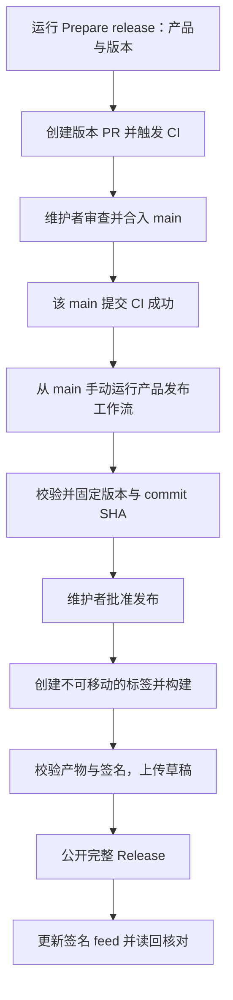

# Anvil 发布流程设计

状态：方案已确认，分项实施中。第 1–4 项已在本地实现，第 5 项仓库设置与操作文档已完成；工作分支正在交付 PR，端到端验收属于第 6 项。参考 [Q2Q CLI 发布流程](https://github.com/mivinci/Q2Q/blob/main/docs/zh/guide/cli-release.md)，结合 Anvil 的安装包、独立 Runtime 和签名更新源设计。

## 目标

版本号和发布内容先经过 PR 合入 main，再从 main 已通过 CI 的确定提交发布。发布过程创建标签，不通过发布后补 PR 来同步版本号。构建、签名、公开 Release 和更新 feed 的状态分别记录，失败可从确定状态恢复。

本方案同时覆盖 Desktop 与 CLI/Runtime，两类产品独立递增版本。首期继续使用现有安装包类型、签名密钥和更新地址。

## 使用流程



日常只需两次操作：先发起版本准备；PR 合并且 main CI 成功后，再发起并批准发布。版本准备不自动合并 PR，也不自动公开版本。

## 产品和版本边界

| 产品 | 版本来源及准备 PR 的改动 | 标签 | 发布内容 |
| --- | --- | --- | --- |
| Desktop | `apps/shell/src-tauri/tauri.conf.json` 与 `apps/desktop/manifests/*.json` 的 version 一起递增 | `desktop/v<version>` | Shell 安装包、App 更新包、校验清单；Desktop 与 Shell 更新 feed |
| CLI / Runtime | 根 Cargo.toml 的 workspace.package.version，及 Cargo.lock 内继承该版本的 workspace 包 | `cli/v<version>` | CLI 压缩包、Runtime 裸二进制、校验和与索引；Runtime 更新 feed |

- 首期 Desktop 的 Shell 安装包与 App 继续共用版本，不新增第三套独立 Shell 发布流程。示例文件 `apps/desktop/app-manifest.json` 不参与正式版本同步。
- Runtime 的版本保持独立；Desktop 包内 Runtime 使用同一提交的 Rust workspace 版本，Desktop 发布不自动更新独立 Runtime feed。
- Runtime 代码变化时，需要同步准备其独立版本，避免不同业务代码长期共用一个 Runtime 版本。联合发布可先准备 CLI/Runtime 版本 PR，再准备 Desktop 版本 PR；两者分别批准发布。具体版本递增不从 Desktop 版本号推导。
- HTTP API 与 Shell API 的兼容版本是另一项显式变更，不随产品版本自动递增。发布校验读取并验证兼容范围。
- 接受 `X.Y.Z`、`X.Y.Z-alpha.N`、`X.Y.Z-beta.N`、`X.Y.Z-rc.N`；数字不允许前导零，首期不接受 build metadata 或任意自定义后缀。
- 同一产品的新版本必须按 SemVer 高于仓库当前版本和已有版本标签，不能复用版本。预发布公开为 prerelease；稳定版遵守现有 latest 策略。
- 平台 manifest 全部同步版本，但实际构建目标以发布矩阵为准，不能将 manifest 存在视为该平台已经提供安装包。

## 第一阶段：准备版本 PR

新增 `prepare-release.yml`，仅允许在 main 手动执行，输入产品 `desktop` / `cli` 和目标版本。

准备脚本应当：

1. 从最新 main 固定基线，验证版本格式、递增关系、产品文件一致性和标签不存在。
2. 只修改对应产品版本文件。CLI 的锁文件更新只允许 workspace 自身版本及必要的本地依赖引用变化，不升级第三方依赖。
3. 创建 `release/desktop-v<version>` 或 `release/cli-v<version>` 分支和 PR。已有同名分支时停止并返回其位置，不强推覆盖。
4. PR 说明展示旧/新版本、预计安装包、关联版本和验证方式；发布说明在 PR 中审查，准备脚本不把未验收功能写成已交付。
5. 使用 GITHUB_TOKEN 创建 PR 后，显式 dispatch Rust CI 到版本分支，处理机器人 PR 默认不触发 pull_request 工作流的限制。
6. 返回 PR 链接，等待维护者审查合并。准备阶段不创建标签、不读取签名私钥、不公开 Release。

main 的 push CI 仍检查合并后的实际提交。仅 PR 分支上的 CI 成功不足以授权发布。首期复用现有完整 Rust CI（含 Desktop job）；按产品进一步拆分影响范围另行优化，不直接照搬 Q2Q 的 apps 依赖判定。

## 第二阶段：发布前校验与批准

`desktop-release.yml` 与 `cli-release.yml` 改为 main 上手动触发的发布入口。正常流程不再以手动推标签作为入口；标签由批准后的工作流创建。

校验阶段固定 `product / version / tag / sha`，后续所有 checkout、构建、打包和上传均使用该 SHA，不再随 main 的推进切换提交。至少检查：

- 入口来自 main，目标提交属于远端 main。
- 所有产品版本文件一致；CLI manifest/lock 一致；Desktop 的各平台 manifest、目标及 API 兼容信息有效。
- 该确切 SHA 的最新可信 Rust CI 已成功，可信事件为 main push 或显式 workflow_dispatch；不能只查询 PR CI 或其他 SHA 的绿色结果。
- CI 缺失、运行中或失败时停止，并说明需要先补跑或完成该提交的 Rust CI。文档路径过滤不构成跳过发布校验的理由。
- 新标签不存在；重试时已有标签只能指向同一 SHA。
- 发布审批环境和所需公开配置有效。

建议使用统一的 `anvil-release` Environment：维护者作为 required reviewer，允许单人维护时自行批准，禁止管理员绕过；部署来源只允许 main。环境未配置或不符合要求时停止，不隐式创建无保护环境继续执行。

审批摘要展示产品、完整版本号、commit SHA、CI 链接、构建平台及将更新的 feed。维护者批准后，执行签名配置校验和标签创建；私钥只在批准后的发布任务中使用，不进入日志、PR 或构建产物。

## 第三阶段：构建和公开

批准后直接调用 reusable workflow，并显式传入 SHA/tag。GITHUB_TOKEN 推送标签不会可靠地触发另一条工作流，因此不依赖“推标签 → 另一个发布工作流”的链式触发。

建议保留独立的 `desktop-release-build.yml` 和 `cli-release-build.yml`，复用脚本中的产品校验和发布恢复逻辑，不构建新的通用发布框架。

### Desktop

- 构建现有四个平台；继续保留各平台前端检查、打包、macOS 签名校验。
- 核对 Shell 安装包版本、App manifest 版本/目标、包内 Runtime 的产品版本与 API 版本，以及必要的兼容声明。
- 明确校验预期的安装包和 App 更新包集合，不能仅依据目录内“有文件”判定完整。
- 生成安装包和更新包的 SHA256SUMS，排除清单自身，使用可直接校验的相对文件名。
- 从最终待上传的 App 包生成签名清单，校验签名私钥与既有公钥匹配、目标/版本/地址/大小/摘要一致。

### CLI / Runtime

- 构建现有四个平台，运行二进制 `--version` 校验产品版本，同时读取并核对 `--serve-api-version`。
- 核对压缩包、裸二进制、校验和及索引的完整性；签名 Runtime 索引绑定实际二进制的大小、摘要、版本与 API。

两类产品均先上传到草稿，读回核对附件集合及摘要后才公开。构建未全部成功时不公开部分安装包。

## 第四阶段：发布更新源

保留现有更新源和稳定/预发布过滤规则：

| 发布产品 | 更新源 |
| --- | --- |
| Desktop | `desktop-updates-stable` 与 `shell-updates-stable` |
| CLI / Runtime | `runtime-updates` |

版本 Release 公开后，才允许 feed 指向其产物。feed 必须使用已公开包的实际字节身份，不能在重试时拿重新构建的不同字节签署同一版本。

同一产品的发布使用固定 concurrency group，`cancel-in-progress: false`；避免按 tag 分组使多个版本同时覆盖同一个 feed。GitHub concurrency 不作为有序队列使用，feed 写入还需比较 SemVer，防止较旧版本后完成而覆盖新版本。

版本 Release 公开和多个 feed 文件更新无法合并为一次原子操作。工作流需分别展示“安装包已公开”和“各更新源已同步”的结果，按目标记录上传状态；读回检查通过后才将整次发布标记为成功。部分 feed 失败时不把整次发布误报为完成。

## 失败与恢复

| 失败位置 | 恢复方式 |
| --- | --- |
| 版本准备或 PR 创建 | 保留已有分支/提交，返回位置供补开 PR；不覆盖同名分支 |
| main CI、版本或审批校验 | 停止发布，补齐条件后重新发起，不提前创建新标签 |
| 构建、签名或草稿上传 | 固定同一标签/SHA 重试；仅草稿允许补传或替换附件 |
| Release 已公开，feed 同步失败 | 使用已公开的产物与索引恢复 feed 发布；不重建覆盖公开安装包，不移动标签 |
| 公开后发现产品或安装包错误 | 修复并准备更高版本的 PR，不复用原版本；发布说明可补充问题提示 |

恢复步骤仍需校验来源 SHA、审批和已有发布身份，不以“已存在 Release”为由直接返回成功。更新源恢复可跳过已经确认成功的构建与附件上传，但需要显式展示恢复阶段及结果。

发布脚本应将“公开版本产物”和“可变更新源”作为不同操作处理；公开版本的保护规则不适用于按设计更新的 feed。

## 实施顺序

每项完成后汇报并确认下一项，不在本方案中提前勾选已实现。

1. [x] **版本准备与校验脚本**：定义产品文件集合、SemVer 校验、精确版本修改与 main/SHA/CI 检查；准备版本 PR 工作流。
2. [x] **Desktop 发布入口**：main 手动触发、Environment 审批、不可移动标签、固定 SHA 的 reusable 构建。
3. [x] **CLI/Runtime 发布入口**：沿用同一顺序，保留独立版本与 Runtime API 校验。
4. [x] **产物与更新源恢复**：草稿完整性、公开产物不可覆盖、feed 防倒退、读回核对和部分失败恢复。
5. [x] **仓库设置与文档**：确认 Actions 创建 PR 权限和 Environment 审批配置；将最终操作步骤写入开发文档。
6. [ ] **验收**：先验证准备版本 PR 和门禁失败路径，再由维护者批准一个真实 alpha；确认 main 先包含版本变更、构建 SHA 固定、安装包与更新源全部就绪。

## 第 1 项当前实现

- `.github/scripts/release.py` 提供 `check`（读取并核对当前产品版本）、`plan`（只读预览版本改动）、`prepare`（版本 PR 与显式 CI dispatch）和 `resolve`（main/SHA/版本/确切提交 CI 的只读发布身份校验）。
- Desktop 只修改 Shell 和 6 份平台 manifest 的 version；CLI 动态识别继承 workspace 版本的本地包，精确修改根 Cargo.toml、Cargo.lock 的自身包版本及必要的本地依赖引用。解析后的完整文档与预期变更比较，防止升级第三方依赖或改动无关字段。
- `.github/workflows/prepare-release.yml` 提供 main 上的产品/版本输入入口。已有分支不覆盖；推送后 PR 创建或 CI dispatch 失败会保留分支并给出恢复位置。准备工作流不打标签、签名或发布。
- `resolve` 输出 product、version、tag、sha 和 CI URL，已接入 Desktop 和 CLI/Runtime 发布入口。

本地完成 Python AST 与 YAML 语法检查，实际读取当前 Desktop/CLI 版本，并只读预览 Desktop `0.1.4-alpha.7`、CLI `0.1.5-alpha.1` 的改动文件集合。上述版本仅用于预览，没有修改产品版本文件、推送准备分支、创建真实版本 PR 或触发 Actions。未新增或运行自动化测试；边界与真实 GitHub 行为留待第 6 项验收。

手动查看当前配置或预览：

```sh
python3 .github/scripts/release.py check --product desktop
python3 .github/scripts/release.py plan --product desktop --version 0.1.4-alpha.7
```

## 验收重点

实施时覆盖版本格式及递增、平台文件不一致、CLI 锁文件越界变更、同名分支/标签、非 main 发起、错误 SHA 或缺失 CI、审批环境缺失、令牌事件不触发下游工作流、各平台产物缺失、签名身份不符、草稿补传、公开产物保护、feed 防倒退与部分发布恢复。真实发布只在维护者明确授权后进行，不为验证流程创建测试正式标签。

## 迁移前提

alpha.6 的发布准备与校验清单修复 [PR #7](https://github.com/mivinci/Anvil/pull/7) 已合入 main，实施基线已同步。既有 alpha.6 标签与公开安装包保持原有身份；新流程从后续版本开始采用。独立 Runtime 版本与 Desktop 内置 Runtime 的更新优先级仍需在实施前核对，避免旧的独立 override 覆盖新安装包内的 Runtime。

## 第 2 项当前实现

- `desktop-release.yml` 改为 main 手动入口，先校验确定 SHA 的 Rust CI、产品版本、公开密钥以及 `anvil-release` 审批策略。缺失环境或读取权限不足时停止，不创建无保护环境。
- 批准后校验 Desktop 私钥与公钥匹配，再创建标签；已有标签只接受同一提交，不移动标签。随后直接调用 `desktop-release-build.yml`，传入固定 SHA/tag。
- reusable workflow 的所有 checkout、版本解析与 feed 初始目标使用固定身份；保留四平台构建、前端检查、macOS 签名检查和现有发布能力。构建任务只读取公钥，私钥仅传入发布任务。
- 固定 Desktop concurrency group 避免不同版本并行修改同一 feed；feed 防倒退、草稿完整性和发布恢复由第 4 项的共用发布脚本处理。

本地仅完成静态语法与配置检查，未运行自动化测试、触发 Actions、创建标签或发布版本。仓库审批环境尚待第 5 项配置和远端验收，当前不能将此项视为发布链路已验收。

## 第 3 项当前实现

- `cli-release.yml` 改为 main 手动入口，复用确切提交的 Rust CI、workspace/lock 版本与审批环境校验。审批前检查 Runtime 公钥，批准后验证私钥身份并创建不可移动的 `cli/v<version>` 标签。
- `cli-release-build.yml` 接收固定 SHA/tag，保留四平台 CLI 压缩包、Runtime 裸二进制、校验清单、签名索引与 Runtime feed；不修改 Desktop 产品版本或发布入口。
- 每个平台同时校验二进制 `--version` 和 `--serve-api-version`。API 校验读取同一提交 `serve.rs` 的显式声明，不推导或递增 API；生成签名索引前再次核对 Linux 二进制。新增 `validate_runtime_api.py` 供这些步骤复用。
- CLI 使用独立的固定 concurrency group；公开 Release 后的恢复、feed 防倒退及附件完整性由第 4 项的共用发布脚本处理。

本地完成 Python/YAML 语法、当前 CLI workspace/lock 一致性和 diff 空白检查；没有编译或运行四平台二进制、运行自动化测试、触发 Actions、创建标签或发布版本。审批环境与远端行为仍待第 5、6 项配置及验收。

## 第 4 项当前实现

两个 reusable workflow 先检查版本 Release：已公开时跳过构建及 artifact 下载，直接以公开附件恢复 feed；没有公开版本时仍要求全部构建成功。发布统一由 `publish_release.py` 执行，阶段与目标结果写入 Actions summary，失败不返回成功。

- 按产品、版本和四平台矩阵核对完整附件集合，拒绝缺失、额外或空文件。Desktop 预发布明确要求 DMG、DEB、NSIS 和四份 App 包；稳定版额外要求 AppImage/MSI。CLI 要求四份压缩包、四份裸二进制及两个索引。
- 发布前校验包内 App manifest 或 Runtime 产品/API 及签名索引身份。SHA256SUMS 覆盖所有版本附件（排除自身），使用平面文件名；先上传草稿，再下载核对附件集合与逐文件摘要，全部一致才公开。
- 草稿允许修复并清理额外附件。公开版本不覆盖附件；恢复时重新确认标签 SHA、公开附件集合与校验清单。CLI 直接使用公开签名索引，核对其签名、API、四平台 URL/大小/摘要以及 archive 索引；Desktop/Shell 从公开安装包和 App 包生成 feed，不重新构建。
- 更新每个 feed 文件前先验证旧签名与产品/目标身份，按 SemVer 保留更高版本；同版本内容不同则拒绝覆盖。上传后逐目标下载并验证签名、版本及内容。部分文件成功、后续失败时保留已成功状态；重试会核对并跳过相同内容，继续剩余目标。
- 产品固定 concurrency group 串行化本工作流的 feed 写入；仓库外的手动写入不受该锁保护，异常读回会停止并报告，GitHub Release API 不提供多文件原子提交。

本地完成 Python/YAML 及内嵌 shell/Python 语法检查、现有产品版本一致性和 diff 检查。未运行自动化测试或真实远端发布；缺件、签名错误、恢复和防倒退的行为验收留待第 6 项，不能将静态检查视为远端恢复已验证。

## 第 5 项当前状态

仓库 Actions 默认 token 保持 read，已开启“Allow GitHub Actions to create and approve pull requests”；准备脚本只创建 PR，不批准或合并。Desktop/Runtime 正式使用的 secret 和公钥变量名称均已确认存在，未读取私钥或轮换密钥。

`anvil-release` 环境已按维护者明确授权配置并读回：required reviewer 为 `mivinci`，允许自行审批，禁止管理员绕过，Selected branches and tags 仅有 Branch `main`。已使用 `release.py` 的实际 `approval_policy` 对远端配置只读核对通过；这使用维护者本地凭据，不代表 Actions GITHUB_TOKEN 读取权限已验收。

`docs/releases.md` 说明版本准备、main 确切提交 CI、发布审批、附件与 feed 检查及失败恢复；`apps/shell/README.md` 的旧推标签发布说明已替换。文档区分本地实现与尚未完成的真实发布验收。

第 5 项已完成。尚未提交或触发工作流；第 6 项仍需在交付工作流后验证真实 GitHub token 权限、门禁失败路径和恢复行为，真实 alpha 发布必须由维护者另行授权。

## 第 6 项验收进度

流程改动 PR #8、Desktop alpha.7 版本准备 PR #9 已合入 main。Prepare release 已真实创建版本分支/PR 并显式派发 CI；发布的确切 main CI、GITHUB_TOKEN 审批策略检查和人工审批均通过。alpha.7 标签固定在 `5bb890d`，四个平台构建全部成功。

发布任务在上传前停止：按标签查询 Release 的 API 对新草稿返回 404，脚本把它误判为不存在/已公开。当前 alpha.7 仍为空草稿，安装包未公开，feed 未更新。修复改为在标签端点返回 404 时分页查找可见的 Release（包含草稿），非 404 错误及列表查询失败保持失败；草稿缺失与已公开分别报错。离线回归覆盖公开版本、分页草稿、不存在、权限及网络失败；维护者凭据的真实只读草稿查询另行核对。

原发布运行固定使用旧提交，直接重跑不会加载后续修复。草稿查询修复 PR #10 已合入。新增 `desktop-release-recover.yml` 作为独立、待审查的 main 手动恢复入口：验证原运行审批/四平台构建/CI/标签 SHA，重新审批后下载原产物，在原源码契约中使用修复后的发布脚本。它不重建产物、不移动标签；原 artifacts 过期时不能恢复草稿。真实恢复及 feed 读回仍未验收，第 6 项保持未完成。
