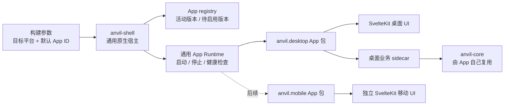

# Anvil Shell 设计草案

状态：设计草案，尚未实现动态 App 包管理。当前代码只完成 Tauri 宿主与 SvelteKit 页面拆分；桌面页面仍由 Tauri 构建流程打包加载。当前 `anvil-shell` crate 还依赖 `anvil-core`，这是骨架阶段的过渡状态，与本文目标边界不一致。

## 目标

Anvil Shell 是通用的原生 App 启动器和版本管理器。打包时指定目标平台与默认 App ID（例如 `anvil.desktop`）；运行时 Shell 按 App ID 定位、启动和维护对应 App 包。App 包可以是桌面、移动端或未来的其他 Anvil App。

Shell 不拥有 Minecraft 业务，不依赖 `anvil-core`，也不定义安装、账户、Java、客户端和服务端等业务命令。每个 App 自己拥有界面、用户流程和业务实现；需要复用公共规则时，由 App 自己的服务端/原生组件调用 `anvil-core`。Shell 只理解通用的 App 清单、入口、兼容性、健康状态和版本生命周期。

## 角色边界



- `apps/anvil-shell/src-tauri` 负责原生启动、App 包发现、版本检查/下载/校验/切换/回滚，以及不含业务语义的通用生命周期管理。
- `apps/anvil-desktop` 是一个 App：拥有 SvelteKit、shadcn-svelte、Lucide 界面和桌面产品流程。它的业务能力不属于 Shell。
- `apps/anvil-mobile` 以后也是独立 SvelteKit App，但拥有自己完全不同的导航、页面布局和交互；不复用 desktop 的页面组件和布局。
- `anvil-core` 仍可作为 Rust 业务库供 CLI 和 App 自己的原生组件复用；Shell 不直接调用 Core，也不承载 Core 的业务命令。
- **桌面推荐方案**：App 包同时带 SvelteKit 静态页面与 App 专属 Rust sidecar。sidecar 依赖 `anvil-core`，拥有客户端/服务端等业务命令；Shell 从已验证包目录启动它、监控健康状态并负责退出清理。页面与 sidecar 用版本化 JSON 消息通过 stdin/stdout 通信，Shell 只转发消息，不解释领域命令。这样页面和 Core 业务实现可随同一 App 包更新，而不必更新 Shell。
- **移动推荐方案**：移动 App 的 SvelteKit 页面和布局独立；平台原生能力作为 `anvil-mobile` 自己的 Rust/Tauri plugin 组件实现，随移动 App 二进制构建，不放进通用 Shell crate。移动平台不支持照搬桌面 sidecar 生命周期。
- 前端共享的 Shell Runtime API 类型可以放入 `packages/shell-api`；在有第二个 App 消费者时创建该包。desktop/mobile 不共享页面布局，可共享版本化的消息 schema、纯类型与确实跨平台的无界面逻辑。

## 构建与 App 选择

构建参数分开表达两个维度；发行包默认内置一份与它匹配的官方 App 包，作为首次启动、离线使用和回滚的基线：

1. **目标平台**：操作系统、CPU 架构或移动平台 target，决定 Shell 和 App 原生组件的产物。
2. **默认 App ID**：例如 `anvil.desktop`，决定这个发行包首次启动时打开哪个 App，以及对应的更新源和最低兼容版本。

App ID 是稳定身份，不把 `desktop` / `mobile` 当作 Shell 内部的业务分支。Shell 源码保持通用；构建流水线按默认 App ID 选择该 App 的静态页面和平台业务组件，封入安装包。桌面 App 首发包还包含对应 OS/架构的 sidecar；移动 App 的原生插件由该移动 App 构建目标链接进安装包。

桌面目标的示意布局：

```text
apps/
  anvil-shell/                 # 通用 Tauri 宿主
  anvil-desktop/               # App 包源码与构建配置
  anvil-mobile/                # 未来的移动 App 包源码与构建配置
```

## App 包与更新

Shell 和 App 页面/业务组件是两个独立的更新对象：

1. **Shell 更新**：只有原生宿主、通用 Runtime 或安全策略变化时才更新 Shell 安装包。
2. **App 更新**：桌面 App 的页面与 sidecar 作为一个带 OS/架构信息的版本包更新，不重新安装 Shell。App 启动时检查一次，运行期间每 24 小时最多检查一次；Shell 在后台静默下载，不中断当前版本。下载完成并通过验证后标记为待启用版本；App 可显示更新状态，但不弹窗打断操作。

Tauri 会把配置为目录的 `frontendDist` 文件嵌入应用二进制，所以当前构建方式不能单独替换页面包。目标方案是 Shell 自带稳定的启动/恢复入口，App 包放入专用应用数据目录，再经受限的本地自定义协议加载；不能默认从公网 URL 执行页面脚本。Tauri 的配置、updater 和安全边界见官方[配置文档](https://v2.tauri.app/reference/config/)、[updater 文档](https://v2.tauri.app/plugin/updater/)与[安全文档](https://v2.tauri.app/security/capabilities/)。

建议的本地布局：

```text
应用本地数据目录/
  apps/
    anvil.desktop/
      0.1.0/
        manifest.json
        web/                   # 静态页面资源
        runtime/               # 桌面 App 专属 sidecar
      active.json              # 当前活动版本
      pending.json             # 已验证、等待下次启动启用的版本
  staging/                     # 下载、解包和验证中的暂存内容
```

清单至少包含 schema 版本、稳定 App ID、包版本、目标平台、页面入口、sidecar 相对路径（桌面）、App/Shell Runtime API 兼容范围、下载大小、内容摘要和发行者签名。Shell 只信任内置的发行者公钥。下载至 staging 后，先验证签名、摘要、大小、平台/API 兼容性和文件路径，再写入不可变的版本目录；拒绝绝对路径、路径穿越、符号链接和超预算文件。激活通过原子更新 `active.json` 完成，当前运行版本不会被覆盖。

## 后台下载、下次启动切换与回滚

1. **运行中检查**：启动时检查一次；App 仍在运行时每 24 小时最多再检查一次。App 发起通用更新检查请求；Shell 读取该 App 已配置的更新源，不接受 App 临时指定任意 URL。
2. **后台准备**：发现新版本后，Shell 下载到 staging，校验签名、哈希、清单、兼容性和解包边界。失败时清理 staging，继续运行旧版本。
3. **标记待启用**：完整验证后写入 `pending.json`，不热替换正在运行的目录，也不打断用户操作。
4. **下次启动尝试新版本**：Shell 启动时检查 pending 包，重新确认关键清单与入口，然后原子切换活动版本并启动。
5. **启动确认与回滚**：新版本必须在 30 秒内完成页面加载，并由 App Runtime 完成通用握手、报告 ready。校验失败、页面不能加载或 Runtime 未 ready 时，Shell 将 `active.json` 恢复到上一个已知可用版本并启动旧版；失败的新版本保留诊断信息，避免每次启动无限重试。
6. **清理**：成功启动后保留最近一个旧版本作为回滚点；更旧版本按磁盘空间策略回收。

离线或更新中断时，活动版本保持不变。初期默认只接受 Anvil 官方签名的 App 包；App manifest 不能自行授予系统权限。任何新系统能力都必须通过受审查的 Shell Runtime API 或 App 自己的平台组件提供。

## 权限与运行边界

- 一个运行实例绑定一个稳定 App ID、版本和目标平台；不同 App 不共用一个可任意切换身份的高权限页面上下文。
- Shell 暴露的 API 只包含 App 生命周期和版本管理等通用操作，不暴露 Minecraft 安装、账户、进程或文件操作命令。
- App 的业务组件拥有自己的接口和权限设计。Shell 负责隔离运行上下文、按清单启动/停止组件、限制可访问的 App 包目录，并对来源、路径和资源使用做校验。
- desktop 与 mobile 可以共享 API schema 和纯逻辑包，但分别维护 SvelteKit routes、布局、样式和组件；移动端不继承桌面导航或页面结构。
- 只有官方 App 包进入首期范围，不提供任意第三方插件或 App Store。

### 移动端更新限制

移动端 App 仍用 SvelteKit，但移动端默认不依赖桌面式的任意页面包热更新。Apple 审核规则限制下载会引入或改变 App 功能的代码；Google Play 对 WebView 中运行的 JavaScript 有解释执行场景的区别，但仍要求动态加载内容不得违反 Play 政策。因此移动安装包应包含完整可用的页面和功能；文案、内容数据和远程配置可独立更新，页面代码、功能与原生能力更新默认走商店发布。若要启用移动 JS bundle OTA，需针对具体平台分发方式和更新内容先完成合规评估。[Apple App Review Guidelines 2.5.2](https://developer.apple.com/app-store/review/guidelines/)，[Google Play Device and Network Abuse policy](https://support.google.com/googleplay/android-developer/answer/16313518)。

## 分阶段交付

1. **当前骨架**：Tauri 宿主加载同级 SvelteKit 构建产物。当前 Shell crate 仍带有 Core 依赖，待边界拆分时移除；npm/Cargo workspace 和跨目录构建已建立。
2. **通用启动与构建选择**：定义平台 target、默认 App ID、App manifest 和通用 Runtime 生命周期；先将内置 `anvil-desktop` 作为静态 App 包启动，不引入 Minecraft 业务命令到 Shell。
3. **App 更新器**：实现运行中检查、后台下载、签名校验、pending 标记、下次启动切换、ready 检查与旧版回滚。
4. **App 业务组件分发**：桌面按“静态页面 + App 专属 sidecar”打包并版本化；移动 App 保持独立 SvelteKit 布局，原生能力编译进移动 App 并通过商店更新。
5. **更多官方 App**：只有出现第二个独立生命周期的 App 时再验证多 App 注册、隔离、数据和存储策略。
6. **第三方扩展**：不在当前目标内；若未来需要，单独设计发行者信任、权限审批、隔离和撤销机制。

## 已确认的产品方向与技术默认值

- 构建包内置目标 App 的完整基线版本，供首次启动、离线运行和更新回滚使用。
- 桌面 App 启动时检查更新，运行期间每 24 小时最多检查一次；更新在后台静默下载。
- 更新在下次 Shell 启动时生效；页面加载且 App Runtime 在 30 秒内完成握手后，才标记新版本健康，否则回退。
- `anvil-mobile` 使用 SvelteKit，但拥有与 desktop 完全不同的 UI、布局、路由和交互；只共享 API schema 与无界面逻辑。

## 仍需技术设计

- 定义 sidecar 的 JSON 消息协议、启动握手、取消/退出与协议兼容策略；建议先用带 schema 版本的 JSON-RPC over stdio，并让 sidecar 直接依赖 `anvil-core`。
- 明确官方更新源的 stable/beta 通道、签名密钥轮换与撤销机制、下载带宽/磁盘上限和用户可见状态。
- 移动端按 iOS/Android 商店政策划定可 OTA 的页面更新范围；新增功能和 native bridge 变化走商店版本。
