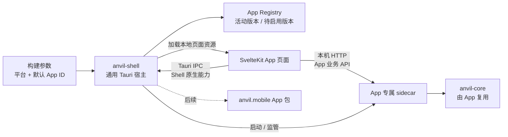
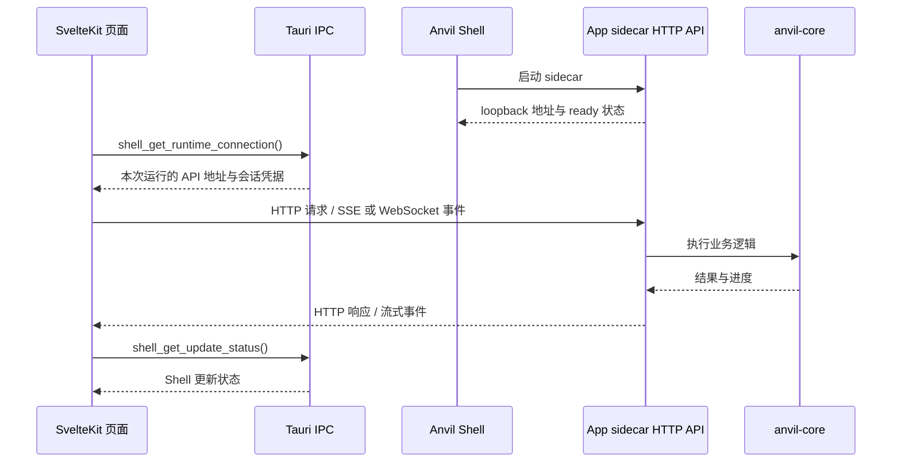

# Anvil Shell 设计草案

状态：设计草案。App 页面协议与恢复入口、按 App ID 隔离的版本存储和原子状态文件、Shell 原生 IPC、sidecar 监管、Runtime 连接引导、基线包构建与首次安装、签名 App 更新下载和验证、下次启动激活与健康回滚均已实现。生产 Shell 只将轻量恢复页作为 `frontendDist`，从活动版本 `web/` 目录加载页面。sidecar 产品业务 API 仍未实现；正式更新 URL 与发行公钥尚未配置。`anvil-shell` 不依赖 `anvil-core`；桌面 sidecar 自己依赖 Core。

## 目标与职责

Anvil Shell 是通用的原生 App 启动器和版本管理器。发行构建指定目标平台与默认 App ID（例如 `anvil.desktop`）；运行时 Shell 按 App ID 定位、启动和维护对应 App 包。App 包可以属于桌面、移动端或未来的其他 Anvil App。

Shell 负责 App 清单、入口、兼容性、健康状态、版本生命周期与 Shell 自身的原生能力。它不拥有 Minecraft 业务，不依赖 `anvil-core`，也不定义安装、账户、Java、客户端或服务端命令。每个 App 自己拥有界面、用户流程和业务 API；需要公共规则时，由 App 的业务组件调用 `anvil-core`。

## Runtime 结构



- `apps/shell/src-tauri` 负责通用启动、App 包发现、更新检查/下载/校验/切换/回滚，以及 App 进程生命周期。
- `apps/desktop` 拥有桌面 SvelteKit、shadcn-svelte、Lucide 界面和产品流程。其业务 API 与实现属于该 App。
- `crates/anvil-desktop-runtime` 是桌面 App 专属 Rust sidecar crate，依赖 `anvil-core` 并提供本机 HTTP API。它作为独立进程随桌面 App 包分发；Shell 启动和监管 sidecar，但不转发或解释业务请求。
- sidecar 是 Shell 管理的 App 进程，可在 App 运行期间常驻；首版不让它脱离 Shell 成为系统级 daemon。Shell 退出时请求 sidecar 有序停止，超时后结束进程。
- `apps/mobile` 以后仍使用 SvelteKit，但拥有不同的导航、页面布局和交互。移动原生能力由该 App 自己的 Tauri plugin 提供，不复用桌面 sidecar 生命周期。
- desktop 与 mobile 可以共享 API schema、纯类型和无界面逻辑，不共享页面布局。只有出现第二个消费者时再抽取 `packages/shell-api` 等共享前端包。

## 页面与 Rust 通信

桌面页面有两种明确的通信路径，按能力归属选择：

1. **Shell 原生能力走 Tauri IPC。** 页面通过显式、类型化的 `invoke()` 命令访问 Shell 拥有的能力，例如 App 身份、版本、更新状态、更新检查和 Runtime 生命周期。更新进度等 Shell 事件可通过 Tauri `Channel<T>` 返回。命令由 Shell 实现，并用 Tauri capabilities 限定可调用窗口。
2. **App 业务 API 走 sidecar 本机 HTTP。** 页面直接请求当前 App sidecar，不经 Shell Rust 转发。账户、客户端、服务端等业务接口由 sidecar 定义和实现；Shell 只负责启动、监管和提供连接引导。当前只实现了健康端点，产品业务接口尚未实现。

### 本地页面协议

生产窗口启动于 `anvil-app://localhost/`。Shell 读取活动版本的 `manifest.json`，校验 App ID、目标平台、Shell API 兼容范围、版本号和 `web/index.html`；协议根路径映射到该入口，其他 URL 路径只映射到同一版本的 `web/` 目录。资源路径在 percent-decode 后拒绝绝对路径、空路径段、`.`、`..`、反斜线、盘符分隔符和符号链接；请求仅支持 GET/HEAD，并按扩展名返回 MIME。页面资源有大小上限，避免协议请求不受控地分配内存。

没有活动版本、manifest 或首页损坏时，Shell 返回随宿主提供的恢复入口。这个恢复页是 Shell 自身唯一的静态页面；桌面 SvelteKit 构建产物不再放入 Shell 的 `frontendDist` 或二进制。开发模式继续从 Vite dev server 加载桌面页面。协议的 fixture 行为由 `apps/shell/tests/app_protocol.rs` 覆盖；Tauri WebView 的各平台 origin 差异仍需在第 10 项 smoke 中确认。



### Shell IPC

前端在 `apps/desktop/src/lib/shell.ts` 集中封装 `shell_get_app_info`、`shell_get_update_status`、`shell_check_for_updates`、`shell_get_runtime_status` 和 `shell_get_runtime_connection`。更新状态使用明确的状态查询；更新器尚未实现时返回 `not_configured`。连接引导只在 Runtime ready 时返回 loopback 地址、当前 API 版本和本次会话凭据；它只提供连接信息，不代理业务方法。

五个 Shell 命令只允许主 WebView 调用：构建时为命令生成 ACL 权限，并通过只匹配 `main` 且没有远程 URL 的 capability 授权；命令也校验窗口 label 和本地 Shell/dev origin。Shell IPC 不接受页面指定的 App ID、程序路径、URL 或任意系统操作。命令按创建该 WebView 时绑定的 App 身份工作；IPC 类型与兼容范围属于 Shell Runtime API。

### App 本机 HTTP API

sidecar 在 `127.0.0.1` 监听动态端口，不绑定公网或局域网网卡。Shell 为每次 App 运行生成 256 位随机会话凭据，经 sidecar stdin 传入；页面通过受限的 Shell IPC 获取连接信息，再使用 Authorization header 调用 API。凭据只存于内存，不写入 URL、日志或持久化配置；App 退出时失效。当前 sidecar 仅有 `/health`，要求授权 GET，并在 OPTIONS 预检中只允许 GET 和 Authorization header。测试覆盖有效/无效凭据、允许/拒绝来源、动态端口和优雅关闭。

业务 API 使用带版本的 schema。短操作使用 HTTP 请求/响应；长操作的进度使用 SSE 或 WebSocket，取消通过明确的 operation ID 接口完成。sidecar 负责业务参数校验、授权与错误映射，前端 typed client 根据 App 自己的 schema 调用它。Shell 不需要理解账户登录、安装或服务端启动等领域方法。

页面资源仍由 Shell 从已校验的本地 App 包加载，不将 sidecar HTTP 服务用作远程页面源。Tauri 生产 CSP 只允许连接 Tauri IPC 和 loopback Runtime；开发 CSP 额外允许本地 Vite HMR。sidecar 只接受 Anvil App 对应的 Tauri origin，开发构建额外允许 `http://localhost:5173`，并拒绝不需要的方法和来源。CORS 是浏览器的跨源访问控制，不是客户端身份验证；本机其他进程可以绕过浏览器 CORS，因此每个 API 请求仍需会话凭据验证，不能只依赖 Origin 或 CORS。[Tauri Content Security Policy](https://v2.tauri.app/security/csp/)、[MDN CORS 指南](https://developer.mozilla.org/en-US/docs/Web/HTTP/Guides/CORS)。

Tauri 官方 sidecar 指南将 localhost、stdin/stdout 和本地 socket 作为可选通信方式，并指出它们各有安全考量；本设计选择本机 HTTP，使桌面页面直接访问 App 业务服务，而 Shell 原生能力继续保留 IPC。[Tauri sidecar 指南](https://v2.tauri.app/learn/sidecar-nodejs/)、[Tauri 前端调用 Rust](https://v2.tauri.app/develop/calling-rust/)。Shell 监管、连接引导、健康端点、基线包和首次安装已实现；App 产品业务 API 仍待实现。

## 构建与 App 选择

构建参数分开表达目标平台、默认 App ID 和当前 Shell API 版本；发行包内置一份匹配的完整官方 App 版本，支持首次离线启动和回滚：

1. **目标平台**：使用 Cargo 的 target triple（例如 `aarch64-apple-darwin`），由 `cargo --target` 决定；同一发行包内的 sidecar 必须匹配这个 target。
2. **默认 App ID**：例如 `anvil.desktop`，由 `ANVIL_DEFAULT_APP_ID` 指定，默认值为 `anvil.desktop`。它决定发行包首次启动的 App。
3. **Shell API 版本**：由 `ANVIL_SHELL_API_VERSION` 指定，默认值为 `1.0.0`；App manifest 声明兼容范围，构建时必须覆盖当前 Shell API 版本。

`ANVIL_APP_MANIFEST` 可指定目标 App manifest；未指定时按 Cargo target 读取 `apps/desktop/manifests/<target>.json`。`apps/desktop/app-manifest.json` 保留为 schema 示例。Shell 构建脚本会拒绝缺少必需字段、未知 schema 版本、默认 App ID 不匹配、目标 triple 不匹配、无效 API 版本或不兼容范围。页面和 sidecar 入口是相对 App 包根目录的正斜杠路径；manifest 解析阶段拒绝绝对路径和 `..`。

manifest schema v1 使用以下字段，版本号采用 SemVer，`shell_api_compatibility` 使用 SemVer version requirement：

```json
{
  "schema_version": 1,
  "app_id": "anvil.desktop",
  "version": "0.1.0",
  "target": "aarch64-apple-darwin",
  "page_entry": "web/index.html",
  "sidecar_entry": "runtime/anvil-desktop",
  "http_api_version": "1.0.0",
  "shell_api_compatibility": "^1.0.0"
}
```

App ID 是稳定身份，不把 `desktop` / `mobile` 当作 Shell 内部的业务分支。Shell 保持通用；构建流水线按默认 App ID 选择页面资源和平台业务组件。桌面发行包内含对应 OS/架构的 sidecar，移动原生 plugin 则由移动 App 构建目标链接进安装包。

Tauri 会将配置为目录的 `frontendDist` 嵌入应用二进制，因此它只指向 `apps/shell/bootstrap` 恢复入口。生产窗口通过本地协议从已校验的活动 App 版本目录加载桌面页面，页面资源不依赖公网 URL，也不编译进 Shell。`npm run desktop:package` 使用 Tauri 传入的 target triple 选择 manifest，并构建静态页面与对应 sidecar；生成的 `apps/desktop/baseline` 由 `bundle.resources` 放进安装包的 `baseline/` 资源目录。

首次启动时 Shell 在用户数据目录创建 staging，拒绝符号链接、非法 manifest、缺失页面或 sidecar、目标平台/API 不匹配和超预算包，然后发布不可变版本并原子设置活动版本。状态写入失败时，下次启动可验证并恢复已发布基线。已有活动版本不被安装包基线替换。App 页面不编译进 Shell 二进制，也不依赖安装后联网下载。首次安装 fixture 测试和本机打包资源的 sidecar 健康流程已通过；实际 WebView 与各平台安装器 smoke 留待第 10 项。

## App 包与更新

Shell 与 App 包是两个更新单元：

- **Shell 更新**：原生宿主、通用 Runtime 或安全策略变化时，更新 Shell 安装包。
- **桌面 App 更新**：静态页面与 sidecar 组成一个带 OS/架构信息、签名和版本号的不可变版本包。App 启动时检查一次，运行期间每 24 小时最多检查一次；Shell 在后台静默下载，不打断当前版本。验证通过后标记为待启用，App 可通过 Shell IPC 展示更新状态。

桌面 App 包目录示意：

```text
应用本地数据目录/
  apps/
    anvil.desktop/
      versions/
        0.1.0/
          manifest.json
          web/                 # 静态页面资源
          runtime/             # App 专属 sidecar
      staging/                 # 下载、解包和验证中的暂存内容
      state.json               # 活动、待启用与上一个健康版本
```

每个 App 包内的 manifest 包含 schema 版本、稳定 App ID、App 版本、目标平台、页面入口、sidecar 相对路径、App HTTP API 版本和 Shell IPC 兼容范围。独立的签名发布清单包含 stable 通道、目标版本、包 HTTPS URL、压缩包大小和 SHA-256；Shell 构建时嵌入发行公钥，只接受 Ed25519 签名。下载器复用锁定版本的 `q2q-http`，将压缩包和恢复记录保存在 `staging/update-<version>/`。摘要通过后，Shell 将 tar.gz 解包到临时版本目录，拒绝绝对路径、路径穿越、大小写冲突、符号链接、其他非普通文件和超预算文件，再校验包内 manifest、目标平台、API 兼容范围及入口。只有验证完整后才发布不可变版本并在 `state.json` 中原子设置待启用版本；活动版本保持不变。

发行构建用 `ANVIL_UPDATE_MANIFEST_URL` 与 `ANVIL_UPDATE_PUBLIC_KEY` 配置 HTTPS 更新清单和 32 字节 Ed25519 公钥，必须同时提供。发布 JSON 的 envelope 使用 `payload`（发布 JSON 原始 UTF-8 字节的十六进制编码）和 `signature`（对这些原始字节的 Ed25519 签名十六进制编码）。默认仓库构建未配置这两个值，更新功能会返回 `not_configured`。目前通道固定为 stable；beta 通道、密钥轮换与撤销策略待正式发布流程确定。

更新按以下流程生效：

1. **检查**：Shell 使用该 App 已配置的更新源；页面不能临时指定任意 URL。
2. **准备**：后台下载新包至 staging，校验签名、哈希、大小、manifest、平台和解包边界。网络中断时保留 q2q-http 可恢复状态；取消或验证失败时活动版本不变，失败的 staging 可安全清理或在后续检查时恢复。
3. **待启用**：完整验证后，在 `state.json` 记录待启用版本。当前页面与 sidecar 继续运行，不覆盖正在使用的文件。
4. **下次启动**：Shell 在退出时请求旧 sidecar 有序停止；下次启动读取待启用版本，把它原子标为待确认的活动候选版，再从同一版本启动 sidecar 并加载页面。sidecar 在 loopback 上开始监听后向 Shell 报告 ready；页面通过 Shell IPC 获取连接信息，完成 `/health` 和 API 版本检查后报告页面 ready。
5. **健康确认与回滚**：sidecar ready、页面加载、App API 兼容性检查和页面 ready 信号必须在启动候选版后 30 秒内完成。Runtime 启动失败、页面报告健康检查失败或超时后，Shell 结束候选 sidecar，将活动版本恢复到上一个已知可用版本并重新启动旧版。状态 schema 2 记录未完成的启动；Shell 意外退出时下次启动自动回滚。失败版本和原因保留在状态中，同一发行版不会自动重试。
6. **清理**：新版本健康后保留最近一个旧版本作为回滚点；更旧版本按磁盘空间策略回收。旧版本自动清理策略尚未实现。

运行中的页面资源与 sidecar 可执行文件均不热替换。下载和验证在后台完成，页面与 Rust 业务组件作为同一 App 版本包，在下一次 Shell 启动时一起切换。离线或更新中断时活动版本保持不变。App manifest 不能自行授予系统权限；新增 Shell 能力必须由受审查的 Shell IPC 提供。

## 安全与平台边界

- 一个运行实例绑定一个稳定 App ID、版本和目标平台；不同 App 不共用一个可任意切换身份的高权限页面上下文。
- Shell IPC 只暴露 App 生命周期和版本管理等通用操作，不暴露 Minecraft 安装、账户、进程或文件操作。
- App 本机 HTTP API 只监听 loopback，采用每次运行的短期凭据、精确的 Tauri origin/CORS allowlist 和受限的 CSP。Origin 与 CORS 不能替代 API 身份验证；不得绑定 `0.0.0.0`、使用通配来源或将凭据写入 URL/日志。
- sidecar 由 Shell 持有生命周期：关闭 App 时先停止接收新操作并请求清理，之后有序退出；超时后由 Shell 结束进程。首版不允许 sidecar 独立于 Shell 留驻。
- 只有官方 App 包进入首期范围，不提供任意第三方插件或 App Store。
- desktop 与 mobile 可以共享 schema 和无界面逻辑，但分别维护 SvelteKit routes、布局、样式和组件。

### 移动端更新限制

移动端 App 仍用 SvelteKit，但默认不依赖桌面式的任意页面包热更新。Apple 审核规则限制下载会引入或改变 App 功能的代码；Google Play 对 WebView 中运行的 JavaScript 有解释执行场景的区别，但仍要求动态加载内容不得违反 Play 政策。因此移动安装包应包含完整可用的页面和功能；文案、内容数据和远程配置可独立更新，页面代码、功能与原生能力更新默认走商店发布。若要启用移动 JS bundle OTA，需针对具体平台分发方式和更新内容先完成合规评估。[Apple App Review Guidelines 2.5.2](https://developer.apple.com/app-store/review/guidelines/)，[Google Play Device and Network Abuse policy](https://support.google.com/googleplay/android-developer/answer/16313518)。

## 实施顺序

逐项交付、验收和当前进度见 [Anvil Shell 执行清单](shell-milestone.md)。按清单顺序逐项推进；本文集中记录架构边界与默认方案，不重复维护执行状态。

## 已确认的默认值与待完成设计

- 构建包内置目标 App 的完整基线版本，供首次启动、离线运行和更新回滚使用。
- 桌面 App 启动时检查更新，运行期间每 24 小时最多检查一次；更新在后台静默下载。
- 页面与 sidecar 作为同一个签名版本包更新，在下次 Shell 启动时生效；页面与 API Runtime 在 30 秒内完成健康握手，否则回退。
- 桌面业务 API 使用 sidecar 提供的本机 HTTP；Shell 原生信息、更新与生命周期能力通过类型化 Tauri IPC 暴露。
- 已确定并实现动态 loopback 端口、每次运行的短期凭据、origin allowlist、健康端点和 Shell 退出时的有序停止；生产/开发 CSP 也已配置。产品 API schema、长操作进度/取消，以及各平台 Tauri origin 与可执行权限仍待后续实现和平台 smoke 验证。
- 更新下载与验证已实现，状态、进度、检查和取消通过 Shell IPC 暴露；正式发行仍需配置更新源和公钥。stable/beta 通道扩展、签名密钥轮换与撤销机制，以及下载带宽策略待发布流程确定；包大小上限当前为压缩 1 GiB、解包后 2 GiB/100,000 个文件。
- 移动端按 iOS/Android 商店政策划定可 OTA 的页面更新范围；新增功能和 native bridge 变化走商店版本。
